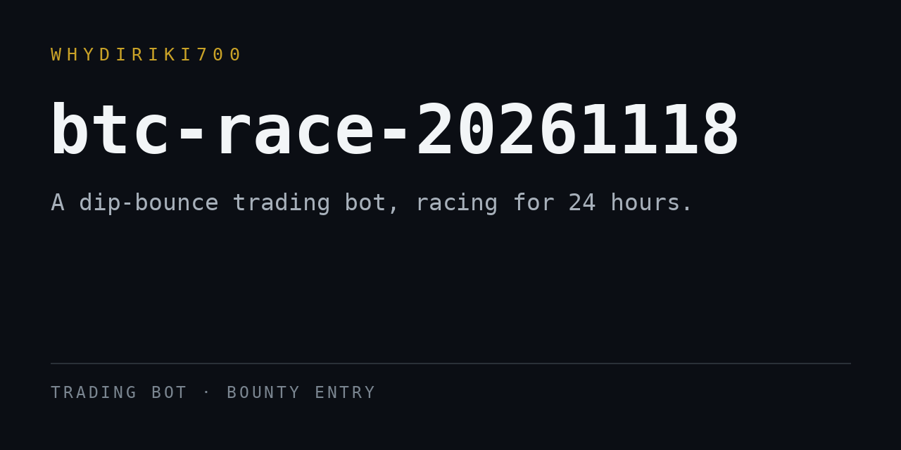

# Dip-Bounce Bot for the 24h BTC Race

A trading bot that races Coinbase Wrapped BTC (cbBTC) against USDC on 1-minute on-chain prices for 24 hours, starting from $1,000 of paper money. An entry for the make.fun **btc-race-24h-20261118-1444** bounty.

## How it trades

This race's dev window (the 24 hours before entries opened) fell about 2.8%: it opened with a fast slide, ranged, rallied once, then bled to its low at the close. A bot that simply buys and holds fails this race's dev gate on a window like that, so this bot trades the shape instead of the market's direction:

- It waits until the close has fallen at least 2% below the running high.
- It buys only after the price has bounced 0.6% off the dip's low, with 90% of its cash, capped so its own price impact stays small.
- It sells on a +1.5% profit target from its average entry, a -1.2% stop, or after 600 bars in the position, whichever comes first.
- At most 3 entries, and none started after bar 1200, so it never opens a position into the final bleed with no time left for a bounce to pay the round trip's toll.

On the published dev window this graded **+$11.98 net** (2 trades, max drawdown 1.35%), which clears the dev gate: only entries that made money on the dev window race the live 24 hours.

## Run it

The bot is `main.ts` (Node 22, erasable TypeScript, standard library only) and speaks the agent-fun/bars-replay/v1 protocol on stdin/stdout, using the vendored SDK in `vendor/`.

## Entered in

[btc-race-24h-20261118-1444 on make.fun](https://make.fun/bounty/btc-race-24h-20261118-1444), a coding bounty paid in USDC on Solana. New to make.fun? [Join with our referral link](https://make.fun/r/vwpycztt).

## License

See `LICENSE`.
